  

  

  
  
  

 

<h2 align="center">🔧 The Garage</h2>

<table>
  <tr>
    <td align="center" width="33%">
      
        
      
    </td>
    <td align="center" width="33%">
      
        
      
    </td>
    <td align="center" width="33%">
      
        
      
    </td>
  </tr>
</table>

 

<h3 align="center">
  <i>"Fast laps start in the garage. Fast releases start in clean code."</i>
</h3>

  Strict types · green builds · steady pace

 

  

 

  

  

